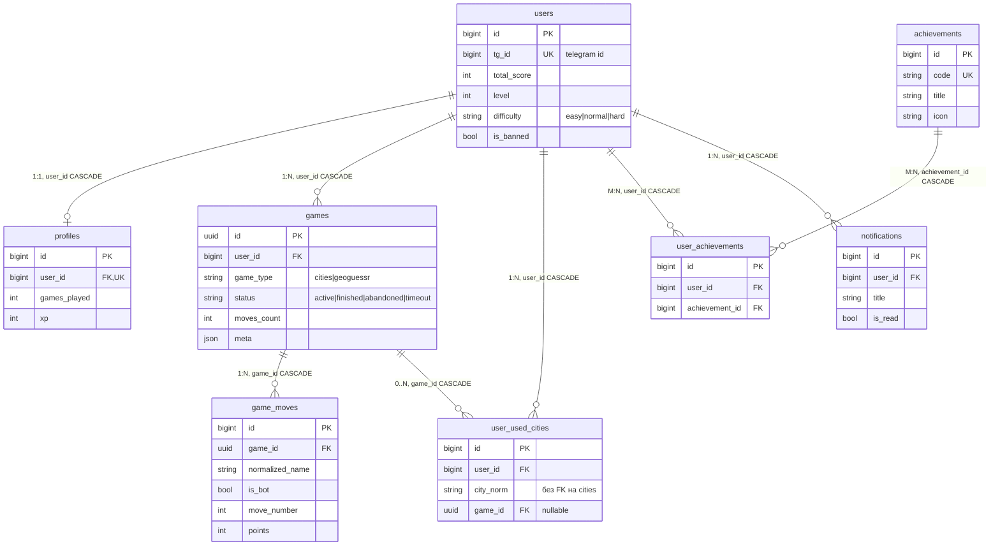

# ER-диаграмма

Схема собрана из `app.models` (12 таблиц), ревизии Alembic
`0001`–`0006` создают ровно этот набор — это проверяет
`tests/integration/test_migrations.py`. Общие поля `id` (`BIGINT`, в SQLite
подменяется на `INTEGER`) и `created_at`/`updated_at` приходят из
`IdMixin`/`TimestampMixin` и на диаграмме не дублируются.

## Связи

## Таблицы без связей (справочники и кеш)

| Таблица | Ключевые поля | Назначение |
|---|---|---|
| `cities` | `normalized_name` (уникальный), `country_code`, `population`, `lat`, `lon`, `source` | справочник городов из GeoNames/Nominatim/сидов; ограничение по населению снято (`CITIES_MIN_POPULATION = 0`) |
| `geo_locations` | `image_url`, `lat`, `lon`, `country_code`, `difficulty`, `source` | панорамы для GeoGuessr, индекс `(source, country_code)` |
| `api_cache` | `key` (PK), `provider`, `value` (`JSONB` в PostgreSQL), `expires_at` | постоянный кеш ответов провайдеров как fallback к Redis |
| `daily_challenges` | `challenge_date` (уникальный), `city_name`, `hint`, `reward_score` | ежедневное задание; FK на `cities` нет, город хранится строкой |

## Ограничения и индексы

- `profiles.user_id` — `UNIQUE` (строго 1:1 с `users`), `CASCADE` при удалении пользователя.
- `user_used_cities` — `UNIQUE (user_id, city_norm, game_id)`: антиповтор в рамках партии.
- `game_moves` — `UNIQUE (game_id, normalized_name)`: город нельзя назвать дважды в одной игре.
- `user_achievements` — `UNIQUE (user_id, achievement_id)`.
- `games` — составной индекс `ix_games_user_status (user_id, status)`;
  дополнительно индексируются `game_moves.move_number`, `cities.country_code`,
  `api_cache.provider`/`expires_at`, `notifications.user_id`.
- `games.game_type` и `games.status` объявлены через `Enum(..., name="game_type"/"game_status")`:
  в PostgreSQL это нативные enum-типы, в SQLite — строки.

## Логические связи без FK

- `user_used_cities.city_norm` соответствует `cities.normalized_name`, но внешнего
  ключа нет — целостность обеспечивается кодом репозитория.
- `daily_challenges.city_name` — свободный текст, не FK.
- `api_cache` и `geo_locations` — самостоятельные таблицы, ссылок на пользователей не имеют.

## Типы ключей

`games.id` объявлен как `Uuid(as_uuid=True)`, и `game_moves.game_id` приведён к
тому же типу (`Mapped[uuid.UUID]`, `app/models/game_move.py`) — расхождение
`Integer`/`Uuid`, которое раньше ломало бы FK на PostgreSQL, устранено.
`user_used_city.game_id` изначально был UUID, поэтому связи `games ↔ game_moves`
и `games ↔ user_used_cities` теперь согласованы.

На SQLite `Uuid` хранится как `CHAR(32)`, `BigInteger`-первичные ключи получают
вариант `Integer` (иначе автоинкремент не работает) — это учтено в миксинах
`app/models/mixins.py` и продублировано в baseline-ревизии `0001`.

## Не подтверждено

- Схема не проверялась на живом PostgreSQL: миграции прогоняются только на
  временной SQLite в `tests/integration/test_migrations.py`, а запуск процессов
  в этой среде запрещён.
- Соответствие моделей и ревизий `0001`–`0006` принимается по тесту
  «upgrade head создаёт все таблицы `Base.metadata`»; содержимое ревизий
  построчно не сверялось.